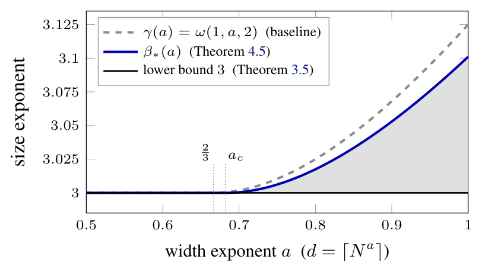
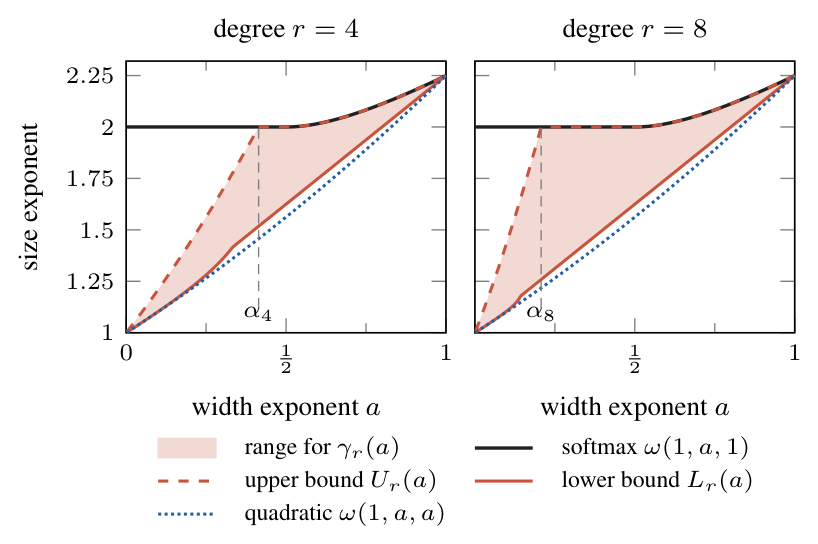
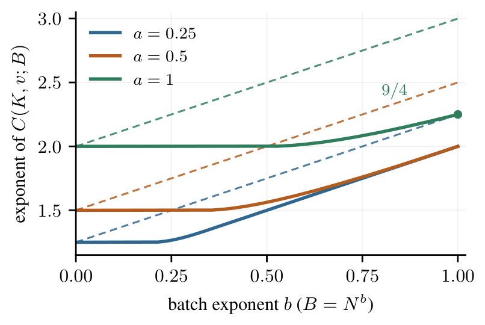
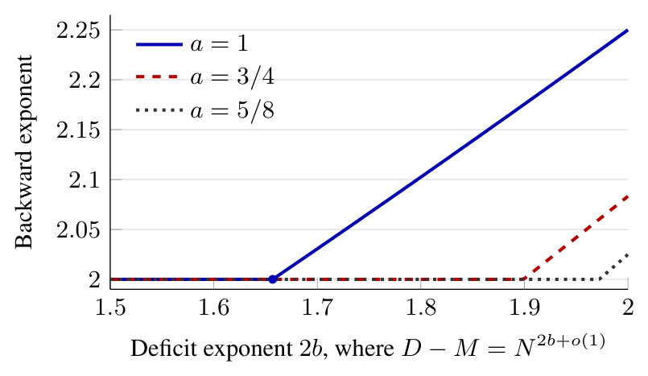
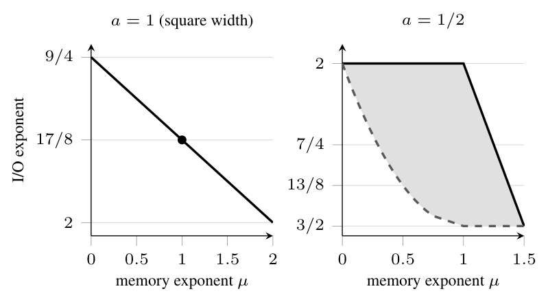
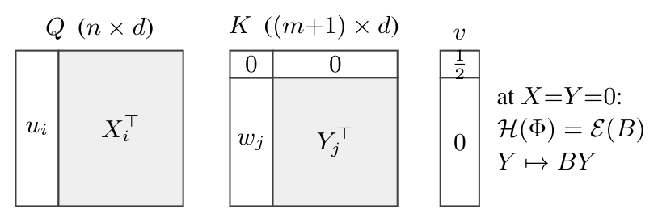
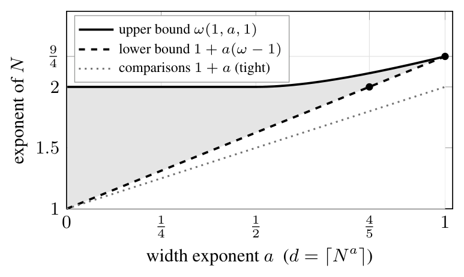
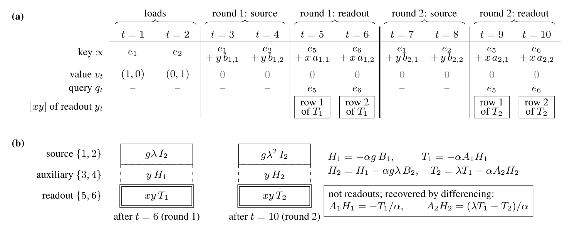
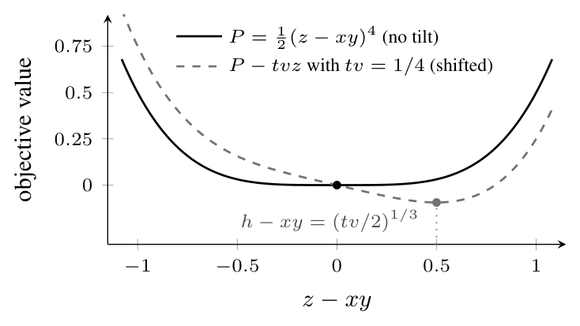

<h1 align="center">Matrix Multiplication and the Complexity of Attention</h1>

  <strong>Tao Jiang</strong> and <strong>Minbo Gao</strong> 
  <em>Co-first authors with equal contribution on every preprint in this collection.</em>

  Institute of Software, Chinese Academy of Sciences 
  School of Computer Science and Technology, University of Chinese Academy of Sciences 
  <a href="mailto:jiangt@ios.ac.cn" aria-label="Email Tao Jiang">jiangt@ios.ac.cn</a> ·
  <a href="mailto:gaomb@ios.ac.cn" aria-label="Email Minbo Gao">gaomb@ios.ac.cn</a>

  <a href="https://jiangxioabai.github.io/research-papers/"><strong>Paper website</strong></a> ·
  <a href="#paper-index"><strong>Paper index</strong></a> ·
  <a href="#how-to-cite"><strong>How to cite</strong></a>

---

A standard attention algorithm forms the query–key score matrix and uses it to compute a weighted sum for each query. Our starting question is whether computing those sums can be asymptotically cheaper than forming the scores.

## Paper index

Click a title for the full abstract or a thumbnail for the figure and its caption.

### Attention

| Paper and abstract | Main result | PDF and citation |
| --- | --- | :---: |
| **[Higher-order attention](https://jiangxioabai.github.io/research-papers/preprints/strassen-and-tensor-attention/)**  | Matches the matrix multiplication exponent for Strassen attention and gives a faster algorithm for tensor attention. | [PDF](./preprints/strassen-and-tensor-attention/paper.pdf) · [BibTeX](./preprints/strassen-and-tensor-attention/README.md#citation) |
| **[Polynomial attention](https://jiangxioabai.github.io/research-papers/preprints/exact-polynomial-attention/)**  | Determines the exact exponent for quadratic attention and gives degree-dependent lower bounds for higher even degrees. | [PDF](./preprints/exact-polynomial-attention/paper.pdf) · [BibTeX](./preprints/exact-polynomial-attention/README.md#citation) |
| **[Preprocessed softmax attention](https://jiangxioabai.github.io/research-papers/preprints/preprocessed-softmax-attention/)**  | Obtains a generic matrix multiplication lower bound even after arbitrary preprocessing of the key–value cache. | [PDF](./preprints/preprocessed-softmax-attention/paper.pdf) · [BibTeX](./preprints/preprocessed-softmax-attention/README.md#citation) |
| **[Attention backpropagation](https://jiangxioabai.github.io/research-papers/preprints/memory-recomputation-attention/)**  | Determines the optimal work exponent for computing value gradients as a function of the forward-pass storage budget. | [PDF](./preprints/memory-recomputation-attention/paper.pdf) · [BibTeX](./preprints/memory-recomputation-attention/README.md#citation) |
| **[Attention I/O complexity](https://jiangxioabai.github.io/research-papers/preprints/unrestricted-attention-io/)**  | Gives matching square-width I/O exponents, conditional on results from a matrix multiplication preprint. | [PDF](./preprints/unrestricted-attention-io/paper.pdf) · [BibTeX](./preprints/unrestricted-attention-io/README.md#citation) |
| **[Arbitrarily accurate softmax attention](https://jiangxioabai.github.io/research-papers/preprints/arbitrarily-accurate-softmax-attention/)**  | Recovers the rectangular matrix multiplication exponent when a bounded-size circuit family can achieve every positive error tolerance. | [PDF](./preprints/arbitrarily-accurate-softmax-attention/paper.pdf) · [BibTeX](./preprints/arbitrarily-accurate-softmax-attention/README.md#citation) |

### Prediction, recurrence, and verification

| Paper and abstract | Main result | PDF and citation |
| --- | --- | :---: |
| **[Batched Top-1 prediction](https://jiangxioabai.github.io/research-papers/preprints/exact-batched-top1/)**  | Matches the matrix multiplication exponent at square width, even though the output contains only the winning indices. | [PDF](./preprints/exact-batched-top1/paper.pdf) · [BibTeX](./preprints/exact-batched-top1/README.md#citation) |
| **[Exact delta-rule computation](https://jiangxioabai.github.io/research-papers/preprints/delta-rule-work-depth/)**  | Gives parallel work bounds conditional on claimed matrix multiplication exponents and an unconditional reduction from triangular substitution. | [PDF](./preprints/delta-rule-work-depth/paper.pdf) · [BibTeX](./preprints/delta-rule-work-depth/README.md#citation) |
| **[Deterministic matrix product verification](https://jiangxioabai.github.io/research-papers/preprints/deterministic-matrix-product-verification/)**  | Shows that verifying a claimed real matrix product has the same arithmetic exponent as computing it. | [PDF](./preprints/deterministic-matrix-product-verification/paper.pdf) · [BibTeX](./preprints/deterministic-matrix-product-verification/README.md#citation) |

## How to cite

Use the BibTeX link for the specific preprint you are citing. Each entry gives the full paper title and lists both co-first authors.

## Research background

Some bounds use results from the [OpenAI square-exponent preprint](https://github.com/openai/math/blob/main/preprints/The-matrix-multiplication-exponent-is-nine-fourths-November-24-2026/README.md) and the [accompanying square and rectangular exponent results](https://github.com/openai/math/blob/main/lean/docs/107.md).
